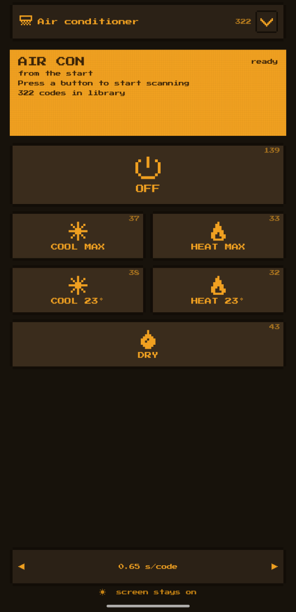
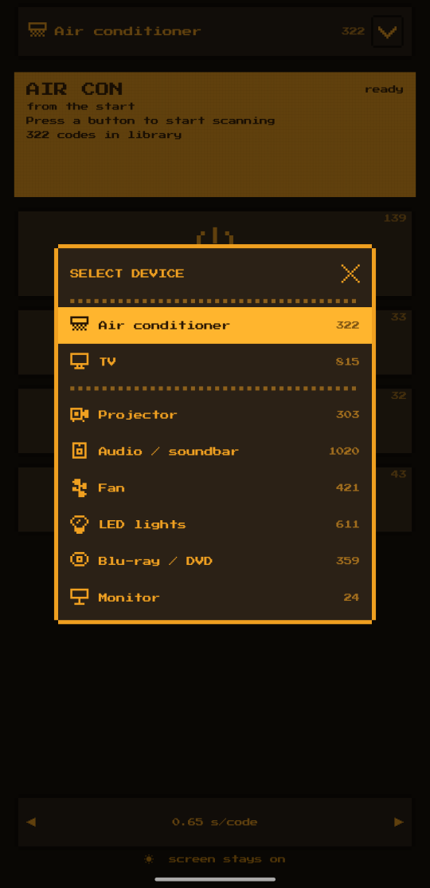
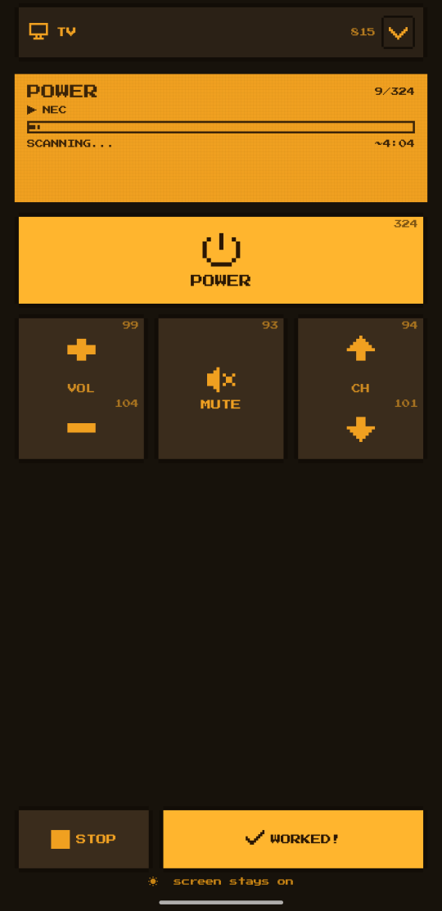
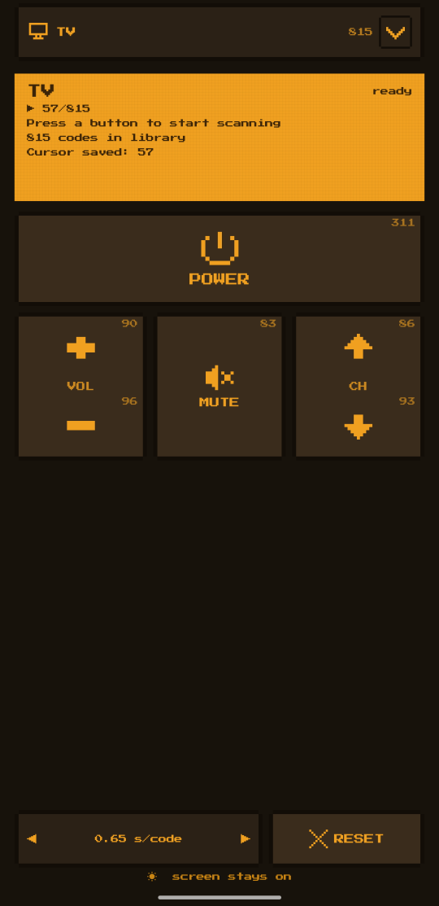
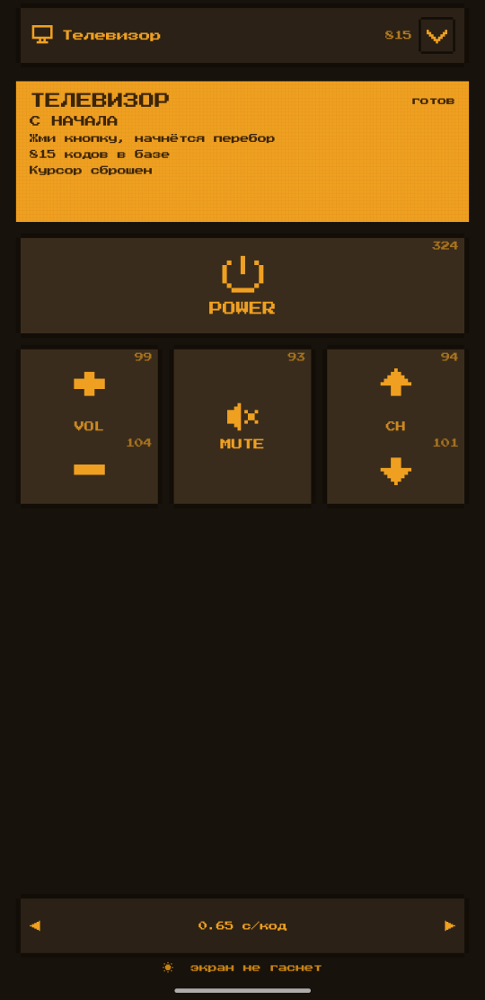
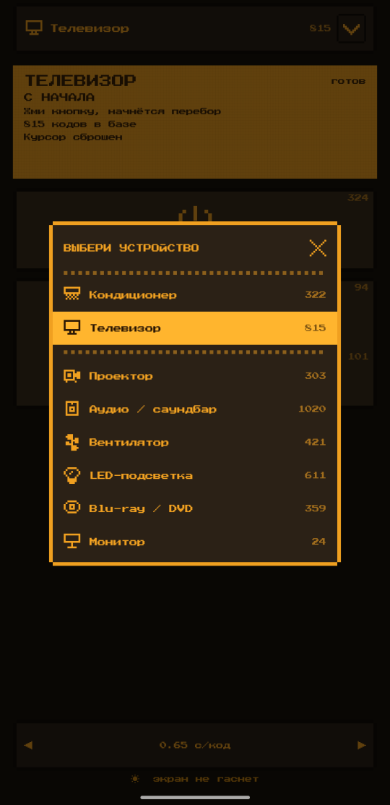
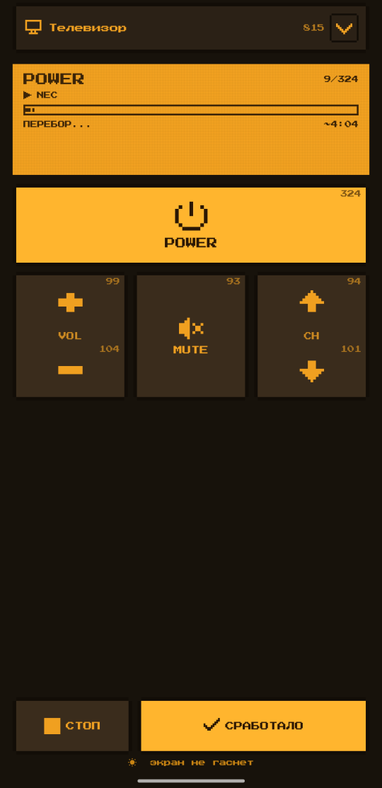

# IR Brute

[English](#english) · [Русский](#русский)

**Download / Скачать:** [latest release APK](https://github.com/oleonov/ir-bruteforcer/releases/latest)

---

## English

Lost the remote? **IR Brute** turns an Android phone with an IR emitter into a brute-force remote.
Pick a device type and a button, and the app sends that button's codes from the
Flipper Zero / Momentum universal IR libraries one after another until your device reacts.

<p>
  
  
  
  
</p>

### How it works

1. Choose the device type: air conditioner, TV, projector, audio, fan, LED lights, Blu-ray/DVD, monitor.
2. Point the phone at the device and press a button, e.g. **OFF** or **POWER**. The app starts sending
   that button's codes; the LCD shows the progress and the remaining time.
3. When the device reacts, tap **WORKED!**. The scan stops and the cursor is set to the code that was sent
   about 5 seconds earlier (your reaction time), so the matching remote is not skipped.
4. Every other button now starts from the same remote, so a few codes are usually enough.
   **STOP** just stops; **RESET** (shown only when a cursor is set) starts from the beginning.

The number on each button is how many codes it will try from the current cursor. Speed is adjustable
(0.25–2 s per code); the screen stays on while the app is open.

### Requirements

Android 8.1+ and a phone with a built-in IR emitter (`ConsumerIrManager`).

### Build

```bash
./gradlew :app:testDebugUnitTest :app:assembleDebug
```

Releases are built by GitHub Actions from tags `vMAJOR.MINOR.PATCH` and signed with the project key.

---

## Русский

Потеряли пульт? **IR Brute** превращает Android-телефон с ИК-передатчиком в пульт-перебор.
Выберите тип устройства и кнопку — приложение по очереди отправит её коды из универсальных
ИК-баз Flipper Zero / Momentum, пока устройство не откликнется.

<p>
  
  
  
</p>

### Как пользоваться

1. Выберите тип устройства: кондиционер, телевизор, проектор, аудио, вентилятор, LED-подсветка,
   Blu-ray/DVD, монитор.
2. Направьте телефон на устройство и нажмите кнопку, например **ВЫКЛ** или **POWER**. Начнётся перебор
   кодов этой кнопки; на экране видны прогресс и оставшееся время.
3. Когда устройство откликнулось, нажмите **СРАБОТАЛО**. Перебор остановится, а курсор встанет на код,
   отправленный примерно за 5 секунд до нажатия (время реакции), чтобы нужный пульт не проскочить.
4. Остальные кнопки теперь начинают с того же пульта, поэтому обычно хватает нескольких кодов.
   **СТОП** просто останавливает перебор, **СБРОС** (виден, только когда курсор установлен) — начинает
   с начала.

Число на кнопке — сколько кодов она переберёт от текущего курсора. Скорость настраивается
(0,25–2 с на код); пока приложение открыто, экран не гаснет.

### Требования

Android 8.1+ и телефон со встроенным ИК-передатчиком (`ConsumerIrManager`).

---

## License / Лицензия

GPL-3.0 — see [LICENSE](LICENSE). Third-party code and data (Flipper Zero encoders, Momentum IR
libraries, Press Start 2P font) are listed in [NOTICE](NOTICE).
